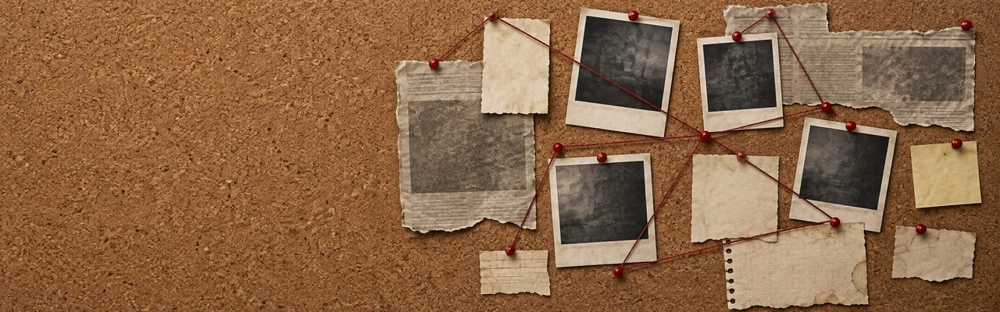

# MR- Pizarra



Una **pizarra de investigación colaborativa** para Foundry VTT. Funciona en **cualquier sistema** y ambientación: corcho, hilos de colores, fotos, notas, recortes de periódico de formas irregulares y los documentos de tus propios diarios colgados con sus permisos.

> Versión 0.1.0 · Foundry VTT 13 · Idiomas: español e inglés

## Cómo se usa

1. En la pestaña **Diarios**, pulsa **Nueva pizarra** (o clic derecho sobre un diario → *Abrir como pizarra*). Cada pizarra es un diario, así que los permisos de siempre mandan: quien tenga Observador puede trabajar en ella.
2. Cada herramienta de la izquierda abre un desplegable con las variantes de su tipo (y **Aleatorio**): elige una y la pieza aparece lista para **escribir directamente sobre ella** (doble clic para volver a editar). «Editar detalles…» abre la ventana completa. Un clic derecho en una pieza abre su menú; con el derecho mantenido sobre el fondo, arrastras la vista.
3. **Selecciona** una pieza con un clic, varias con Mayús/Ctrl o con un recuadro arrastrando en vacío (Ctrl/Cmd+A, todas). Todo lo seleccionado se mueve junto; las **esquinas** de la caja lo escalan y el **círculo superior** lo gira, y los hilos se adaptan. Una barra sobre la selección ofrece girar, escalar, alinear, duplicar y más.
4. **Arrastra desde la barra lateral** diarios, páginas, actores, escenas u objetos: quedan colgados y respetan los permisos de cada persona.
5. **Quitar**: selecciona y pulsa **Suprimir**. **Ctrl/Cmd+Z** deshace cualquier cambio.
6. **Hilo**: elige color y estilo, pulsa dos piezas y se unen; los hilos pasan por delante de las piezas. Un clic en el hilo permite ponerle etiqueta o quitarlo.
7. **Fondo**: 19 fondos por ambientación (corcho, victoriano, casa maldita, Oeste, sala de guerra, ciberpunk, nave espacial…).
8. **Sujeción por defecto** (barra superior): elige tipo, color y colocación del celo, las chinchetas o los clips para toda la pizarra; cada pieza o selección puede cambiarla desde su barra.
9. **Accesibilidad** (barra superior): tamaño de texto, letra legible, alto contraste, reducir movimiento e interfaz grande; Tab recorre las piezas y los lectores de pantalla reciben avisos.

## Lo que ven los jugadores

| Permiso sobre el documento | Qué aparece en la pizarra |
|---|---|
| Observador o más | El contenido: el texto como recorte de periódico, las imágenes como foto. |
| Limitado | Solo el título; el texto sale censurado con barras y un sello «RESERVADO». |
| Ninguno | Un sobre con «?», sin nombre. |

Si subes el permiso del diario, la pieza se revela sola.

## Para la Guardiana

- **Ocultar** una pieza la quita de la vista de los jugadores hasta que la **reveles** (aparece con una animación).
- **Privada**: solo la ve quien la creó (y la Guardiana).
- **Bloquear** la pizarra la deja en solo lectura para los jugadores.
- Por defecto una pizarra nueva se comparte con los jugadores como Observadores; se puede desmarcar al crearla.

### Límites que conviene conocer

- Las piezas ocultas o privadas se filtran en el cliente: siguen estando en los datos del diario. No cuelgues secretos reales que un jugador avispado pueda leer con la consola.
- Los jugadores sin permiso de Propietario guardan sus cambios a través de la Guardiana: si no hay ninguna conectada, la pizarra solo se puede consultar.
- Los documentos de compendios no se pueden colgar: impórtalos antes al mundo.

## API

```js
const api = game.modules.get("mr-pizarra").api;
await api.createBoard("Caso del Faro", { background: "corcho-noir", share: true });
api.open("Caso del Faro");           // por nombre, id o documento
await api.convertToBoard(journal);   // convierte un diario existente
```

## Instalación

Manifiesto: `https://github.com/ManuRomera/mr-pizarra/releases/latest/download/module.json`

## Créditos y licencia

Código bajo licencia MIT. Las imágenes se generaron para este módulo y se limpiaron con `tools/prepare-assets.py`.
